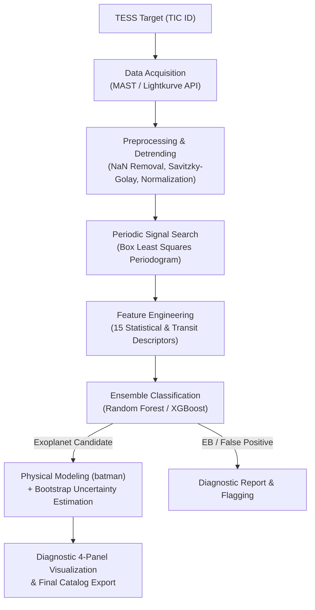
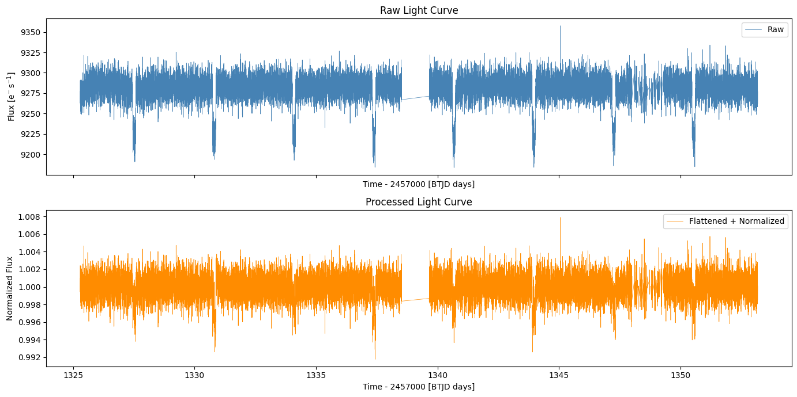
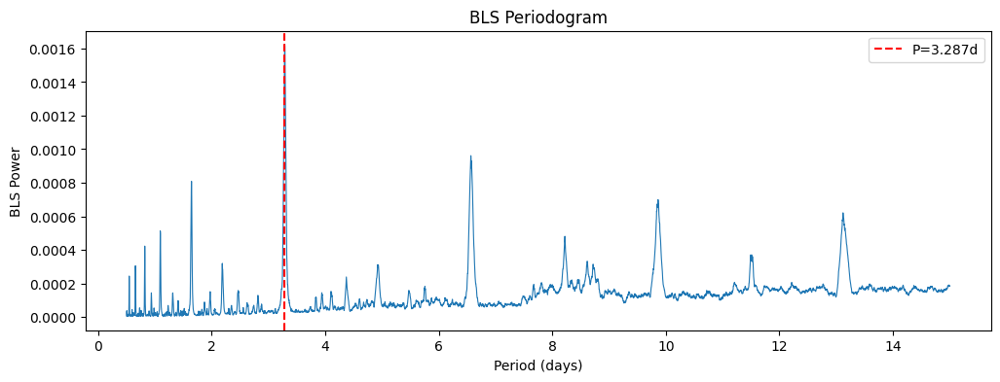
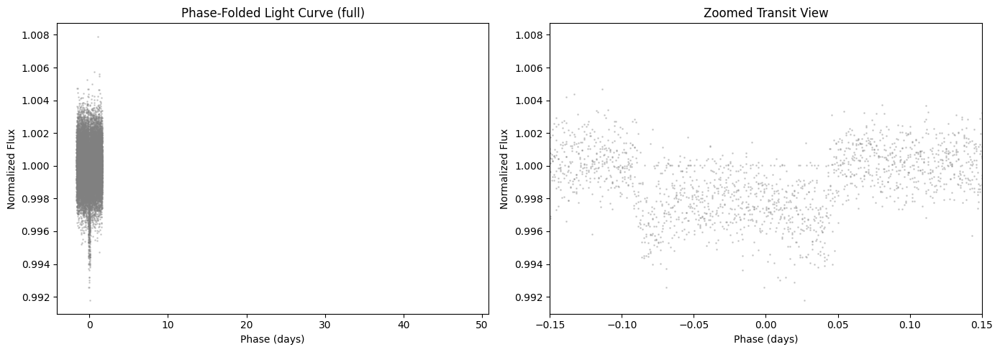
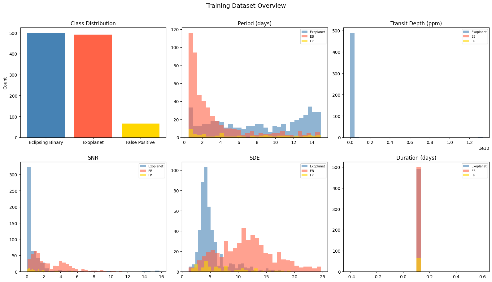
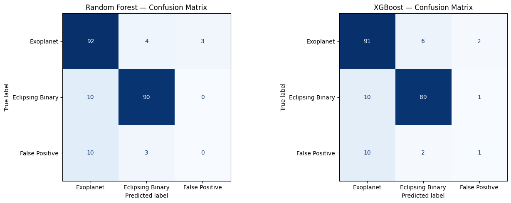
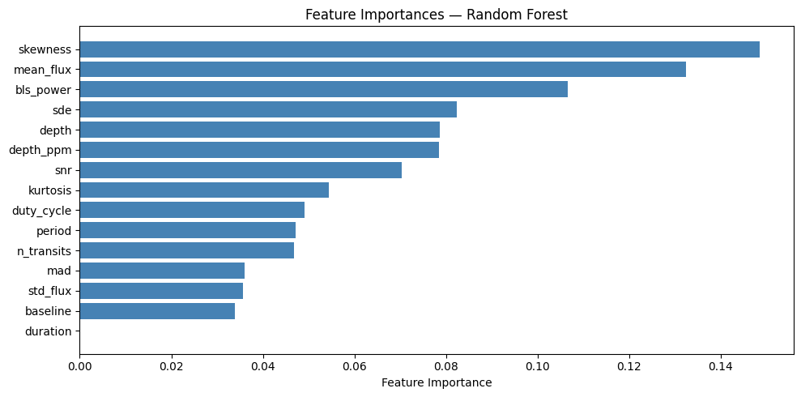
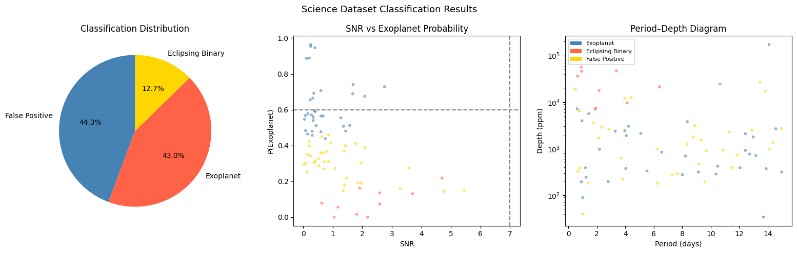
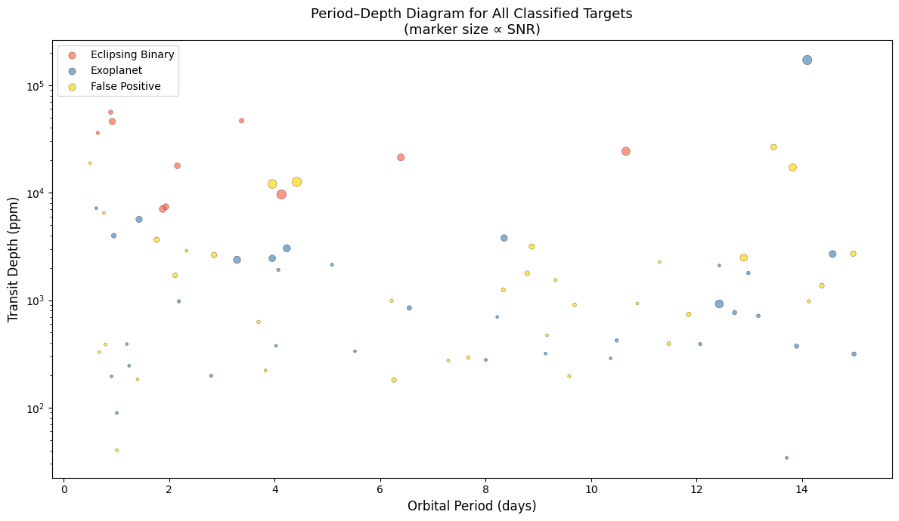

# AI-Enabled Exoplanet Detection Pipeline

[](https://www.python.org/)
[](https://www.astropy.org/)
[](https://docs.lightkurve.org/)
[](https://scikit-learn.org/)
[](https://xgboost.readthedocs.io/)
[](https://opensource.org/licenses/MIT)

An automated, machine learning-driven transit photometry pipeline designed to identify and vet exoplanet transit candidates from NASA's **Transiting Exoplanet Survey Satellite (TESS)** mission.

The pipeline downloads calibrated SPOC 2-minute cadence light curves from the Mikulski Archive for Space Telescopes (MAST), removes stellar variability and instrumental trends, conducts periodic signal searches with the **Box Least Squares (BLS)** periodogram, extracts 15 astrophysical and statistical features, and classifies candidates into **Exoplanets**, **Eclipsing Binaries (EBs)**, or **False Positives (FPs)**. High-probability candidates are further fitted with analytical physical transit models (`batman`) and bootstrap resampling to infer orbital and planetary parameters with observational uncertainties.

---

## Architecture & Workflow



---

## Pipeline Overview

### 1. Data Ingestion & Preprocessing
Raw light curves from space telescopes feature long-term stellar variability (e.g., starspot rotations), instrumental drift, and gaps.
- Light curves are pulled via `lightkurve.search_lightcurve` with automated fallback (`SPOC` $\rightarrow$ `TESS-SPOC` $\rightarrow$ any author).
- Systematic trends are removed using a Savitzky–Golay filter (`flatten(window_length=401)`).
- Flux values are normalized to a median baseline of 1.0.


*Figure: Raw calibrated TESS light curve (top) versus flattened and normalized photometric flux (bottom) for TIC 25155310.*

---

### 2. Transit Search via Box Least Squares (BLS)
Periodic transit signals are detected using Astropy's `BoxLeastSquares` algorithm over a period grid ranging from 0.5 to 15 days.
- The period yielding the maximum BLS power is isolated to establish the transit period $P$, central transit epoch $t_0$, duration $T$, and transit depth $\delta$.
- Phase folding stacks all observed transits into a unified phase space, and binning highlights the characteristic U-shaped dip.

| BLS Periodogram | Phase-Folded Transit |
| :---: | :---: |
|  |  |
| *BLS power spectrum showing primary detection peak at $P = 3.287\text{ d}$.* | *Phase-folded transit curve (full orbit left, ingress/egress transit zoom right).* |

---

### 3. Feature Engineering Engine
For every target star, 15 interpretable astrophysical and statistical features are computed from the detrended light curve and BLS periodogram:

| # | Feature Name | Description | Astrophysical / Statistical Motivation |
|---|---|---|---|
| 1 | `period` | Best-fit BLS period (days) | Identifies orbital resonance and cadence separation |
| 2 | `depth` | Fractional flux dip $(\Delta F / F)$ | Proxy for planet-to-star area ratio $(R_p/R_s)^2$ |
| 3 | `duration` | Transit duration (days) | Constrains chord length across stellar disc |
| 4 | `duty_cycle` | Ratio: $\text{duration} / \text{period}$ | Distinguishes compact vs wide orbital architectures |
| 5 | `depth_ppm` | Transit depth in parts-per-million | Separates shallow planetary transits from deep stellar eclipses |
| 6 | `bls_power` | Peak power in the BLS periodogram | Quantifies periodic dip signal strength over white noise |
| 7 | `sde` | Signal Detection Efficiency: $\frac{\text{power}_{\max} - \mu_{\text{power}}}{\sigma_{\text{power}}}$ | Robust metric for signal confidence against noise fluctuations |
| 8 | `snr` | Signal-to-Noise Ratio: $\text{depth} / \sigma_{\text{flux}}$ | Detectability threshold indicator |
| 9 | `mean_flux` | Mean normalized stellar flux | Baseline stability metric |
| 10 | `std_flux` | Standard deviation of normalized flux | Measures scatter, stellar jitter, and photometric noise |
| 11 | `mad` | Median Absolute Deviation of flux | Outlier-resilient measure of stellar dispersion |
| 12 | `skewness` | Fisher-Pearson skewness coefficient | Captures one-sided negative flux drops characteristic of transits |
| 13 | `kurtosis` | Excess kurtosis of flux distribution | Quantifies heavy tails in light curve distribution |
| 14 | `baseline` | Total observation timespan (days) | Accounts for observational coverage (single vs multi-sector) |
| 15 | `n_transits` | Expected transits: $\text{baseline} / \text{period}$ | Verifies statistical repeatability of observed dips |

---

## Dataset & Class Definitions

The training dataset comprises **1,057** real TESS stars sampled across three distinct photometric classes:
- **Exoplanet Hosts (`Class 0`, $N = 491$)**: Confirmed planet hosts queried from the **NASA Exoplanet Archive** (`pscomppars` TAP service).
- **Eclipsing Binaries (`Class 1`, $N = 500$)**: Stellar binaries sampled from the official **TESS Eclipsing Binary Catalogue** (MAST HLSP).
- **False Positives / Blends (`Class 2`, $N = 66$)**: Background eclipsing binaries, instrumental noise spikes, and stellar variability cataloged as false positives by the **TESS Follow-up Observing Program (TFOPWG)**.


*Figure: Class distribution and marginal feature histograms (Period, Depth, SNR, SDE, Duration) across Exoplanets, Eclipsing Binaries, and False Positives.*

Data acquisition uses an incremental, resume-safe caching mechanism (`exo_train.csv`, `eb_train.csv`, `fp_train.csv`) to prevent loss of downloaded products during long-running network operations.

---

## Machine Learning Models & Benchmark

The dataset was partitioned into an **80/20 stratified train/test split** (845 train / 212 test) to preserve minority class ratios. Both a **Random Forest Classifier** (`n_estimators=500`, `max_depth=12`, `min_samples_leaf=2`) and an **XGBoost Classifier** (`n_estimators=400`, `max_depth=6`, `lr=0.05`) were evaluated on the held-out test set ($N = 212$).

### Test Set Performance ($N = 212$)

| Model | Class | Precision | Recall | F1-Score | Support | Overall Accuracy |
|---|---|:---:|:---:|:---:|:---:|:---:|
| **Random Forest** | **Exoplanet** | 0.82 | 0.93 | **0.87** | 99 | **85.85%** |
| | **Eclipsing Binary** | 0.93 | 0.90 | **0.91** | 100 | *(5-fold CV:* |
| | **False Positive** | 0.00 | 0.00 | 0.00 | 13 | *85.52% ± 0.95%)* |
| **XGBoost** | **Exoplanet** | 0.82 | 0.92 | **0.87** | 99 | **85.38%** |
| | **Eclipsing Binary** | 0.92 | 0.89 | **0.90** | 100 | |
| | **False Positive** | 0.25 | 0.08 | 0.12 | 13 | |

### Confusion Matrices & Feature Importances

| Confusion Matrices (RF vs XGBoost) | Feature Importances (Random Forest) |
| :---: | :---: |
|  |  |
| *Separation of planetary transits from eclipsing binaries; minority FP class unlearned due to severe class imbalance.* | *Top classification drivers: `skewness` (0.149), `mean_flux` (0.132), `bls_power` (0.107), `sde` (0.082).* |

#### Key Insights:
1. **High Separability of Real Transits vs Binaries**: Both models reliably separate planetary dips from deep stellar eclipses ($F_1 \ge 0.87$ for exoplanets, $F_1 \ge 0.90$ for EBs).
2. **False Positive Deficit**: The false-positive class constitutes only 6% of training data, leading to severe under-representation. Macro-$F_1$ ($\approx 0.60$) provides a more realistic assessment than raw accuracy.
3. **Astrophysical Drivers**: Flux `skewness` emerged as the most critical discriminator, directly capturing asymmetric dips in the photometric distribution.

---

## Physical Transit Modeling (`batman`)

When a target is classified as a likely planet with high significance ($\text{SNR} > 5$), the pipeline fits an analytical physical model using the `batman` transit calculation package:
- Incorporates a **quadratic limb-darkening law** ($u_1 = 0.3, u_2 = 0.2$, circular orbit $e=0$, inclination $i=88^\circ$).
- Derives physical planetary radius ratio ($R_p/R_s$) and scaled semi-major axis ($a/R_s$).
- Employs **100-iteration bootstrap resampling** to determine empirical $1\sigma$ uncertainties on period, transit depth, and duration.

---

## Batch Science Inference (TESS Sector 1)

The trained Random Forest pipeline was deployed on an uncurated batch of targets from **TESS Sector 1**:
- **79 stars** successfully processed end-to-end.
- Raw classification breakdown: **34 Exoplanets (43.0%)**, **35 False Positives (44.3%)**, **10 Eclipsing Binaries (12.7%)**.
- Candidate selection filtering was applied using strict significance gates: $\text{SNR} > 7$ and $\text{Confidence} > 0.60$.

| Science Sample Results | Period–Depth Demographics |
| :---: | :---: |
|  |  |
| *Class composition, SNR versus exoplanet probability, and preliminary period-depth mapping.* | *Period–depth demographic diagram across all classified targets, scaled by detection SNR.* |

### Top Predicted Exoplanet Candidates (Sector 1)

| TIC ID | Confidence | SNR | SDE | Period (d) | Depth (ppm) | Duration (d) | Expected Transits |
|---|:---:|:---:|:---:|:---:|:---:|:---:|:---:|
| **259168516** | 0.964 | 0.25 | 4.27 | 12.431 | 2,098 | 0.10 | 2.2 |
| **233095291** | 0.953 | 0.25 | 5.13 | 8.222 | 699 | 0.10 | 3.4 |
| **141608198** | 0.946 | 0.40 | 5.14 | 12.982 | 1,788 | 0.10 | 2.1 |
| **441765914** | 0.888 | 0.20 | 4.31 | 5.522 | 335 | 0.10 | 4.9 |
| **371188886** | 0.887 | 0.11 | 4.87 | 9.136 | 319 | 0.10 | 2.6 |
| **179317684** | 0.740 | 1.69 | 8.62 | 4.230 | 3,039 | 0.10 | 5.7 |
| **25155310** | 0.689 | 1.67 | 11.96 | 3.287 | 2,376 | 0.10 | 8.5 |

---

## Known Limitations & Roadmap

| Current Pipeline Constraint | Cause | Engineering Solution |
|---|---|---|
| **Fixed BLS Duration ($0.1\text{ d}$)** | Astropy BLS duration was held constant, reducing duration importance to 0.0. | Implement a dynamic duration grid proportional to trial period: $T \approx \frac{R_* P}{\pi a}$. |
| **False-Positive Under-Sampling** | Hardcoded list contained only 66 FP stars vs ~500 for planets/EBs. | Query full NASA ExoFOP-TESS disposition tables and apply SMOTE or cost-sensitive class weights. |
| **No Odd/Even Transit Test** | Pipeline lacks primary vs secondary eclipse comparison. | Compute $\Delta \text{Depth}_{\text{odd-even}}$ and secondary eclipse search to filter grazing eclipsing binaries. |
| **Single-Sector Baseline ($\sim 28\text{ d}$)** | Single sector limits detection to periods $P \le 14\text{ d}$. | Stitch multi-sector light curves (`lk.LightCurveCollection.stitch()`) for longer orbital baselines. |
| **Bootstrap Parameter Fits** | Batman parameters are initialized from BLS without nonlinear optimization. | Couple `batman` with MCMC parameter estimation (`emcee` or `dynesty`) for full posterior distributions. |

---

## Project Structure

```text
├── assets/                           # Figures and diagnostic diagrams
│   ├── bls_periodogram.png
│   ├── confusion_matrices.png
│   ├── dataset_distribution.png
│   ├── feature_importances.png
│   ├── period_depth_diagram.png
│   ├── phase_folded_transit.png
│   ├── raw_vs_flattened_lightcurve.png
│   └── science_sample_results.png
├── data/                             # Cached training and inference datasets
│   ├── exo_train.csv
│   ├── eb_train.csv
│   ├── fp_train.csv
│   ├── training_dataset.csv
│   └── final_results.csv
├── models/                           # Serialized model binaries
│   ├── best_classifier.pkl
│   ├── random_forest.pkl
│   └── xgboost.pkl
├── pipeline/                         # Core Python modules
│   ├── acquisition.py                # MAST/lightkurve downloader with fallbacks
│   ├── preprocessing.py              # Detrending and normalization
│   ├── bls_search.py                 # Box Least Squares periodogram runner
│   ├── features.py                   # 15-feature extraction engine
│   ├── modeling.py                   # batman physical model & bootstrap uncertainties
│   └── visualizer.py                 # 4-panel candidate diagnostic suite
└── README.md
```

---

## Installation & Setup

```bash
# Clone the repository
git clone https://github.com/username/exoplanet-detection-pipeline.git
cd exoplanet-detection-pipeline

# Create and activate virtual environment
python -m venv venv
source venv/bin/activate  # On Windows: .\venv\Scripts\activate

# Install required dependencies
pip install lightkurve astropy astroquery batman-package scikit-learn xgboost pandas numpy scipy matplotlib joblib tqdm
```

---

## Quickstart

### Run Inference on a Single TESS Target
```python
from pipeline.acquisition import get_lc
from pipeline.features import extract_features
from pipeline.modeling import fit_transit_batman
from pipeline.visualizer import plot_full_analysis
import joblib
import pandas as pd

# Load pre-trained model
model = joblib.load("models/best_classifier.pkl")

# Download and analyze TIC 25155310
tic_id = 25155310
lc = get_lc(tic_id)
features = extract_features(lc)

# Classify
X = pd.DataFrame([features])
prediction = model.predict(X)[0]
confidence = model.predict_proba(X)[0].max()

labels = {0: "Exoplanet", 1: "Eclipsing Binary", 2: "False Positive"}
print(f"Target: TIC {tic_id}")
print(f"Prediction: {labels[prediction]} ({confidence * 100:.1f}% confidence)")
print(f"Period: {features['period']:.4f} days | Depth: {features['depth_ppm']:.1f} ppm")
```

---

## References & Data Sources

1. **Kovács, G., Zucker, S., & Mazeh, T. (2002)**. *A box-fitting algorithm in the search for periodic transits.* Astronomy & Astrophysics, 391, 369–377.
2. **Kreidberg, L. (2015)**. *batman: BAsic Transit Model cAlculatioN in Python.* PASP, 127, 1161.
3. **Lightkurve Collaboration (2018)**. *Lightkurve: Kepler and TESS time series analysis in Python.* Astrophysics Source Code Library.
4. **Prša, A., et al. (2022)**. *TESS eclipsing binary stars. I. Short-cadence observations in sectors 1–26.* ApJS, 258, 16.
5. **NASA Exoplanet Archive**: Confirmed planet parameter queries via TAP service (`https://exoplanetarchive.ipac.caltech.edu`).
6. **Mikulski Archive for Space Telescopes (MAST)**: TESS mission high-level science products (`https://archive.stsci.edu`).
